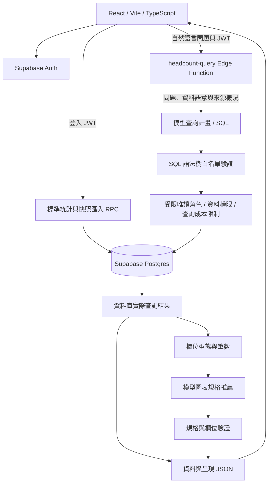

# AI Headcount 目前架構

2026-11-18，React 工作台與 NVIDIA NIM／Google API 版本。

## 資料

`headcount_private.snapshots` 保存來源、基準日、檔名、擁有者、示範標記與時間。
`headcount_private.records` 保存機關、主管代碼、民國年、人力類別與員額指標。
四份來源被正規化為每機關、年度、人力類別一列。原始檔沒有包含的指標保持 NULL。

`analytics.active_snapshots` 於各使用者可見範圍內，為每個來源選擇最近的個人批次，否則使用示範批次。所有分析檢視表使用 `security_invoker=true`，並保留底層 RLS。

`public.headcount_query_history` 保存使用者自己的問題、SQL、結果與時間。資料保留當時的來源批次資訊，重新開啟歷史結果不會自動重新執行 SQL。

## 信任邊界

- 前端不能取得模型 API Key 或伺服器金鑰。
- 使用者 JWT 由 Edge Function 驗證，輸入不能指定其他使用者 ID。
- 寫入限於個人快照與後端自己的查詢紀錄。
- 動態 SQL 僅在驗證後執行；受限 executor 擁有者不能寫入業務表，不能讀取 auth／vault／系統表資料。
- 特權函式實作放在未暴露的 private schema；public RPC 僅為受限包裝介面。
- 模型輸出僅是資料，前端不使用 eval、模型生成的 HTML 或 JavaScript。
- 圖表引用回傳欄位，資料庫數值不經模型改寫。

## 已知範圍

這是可手動驗證的開發版本，SQL 語法採受限 PostgreSQL 子集，不能保證每種任意分析問法都能執行或具有正確業務語意。模型失敗會顯示錯誤或澄清，不會用捏造結果取代。正式資料需擴充真實機關階層、日期與人力類別對照，並確認 D5 請增／核增的業務差異。

目前個人匯入互相隔離，尚未加入團隊資料共享、管理者核准匯入、舊快照切換或正式環境稽核治理。

## 2026-11-19 供應商切換

新增 NVIDIA NIM Chat Completions 介接，主模型由 NVIDIA_MODEL 選擇。原有 Google 介接保留，以 LLM_PROVIDER 控制；未明確指定且 NVIDIA_API_KEY 存在時使用 NVIDIA。不會自動向其他供應商傳送問題。兩種介接共用 SQL 語法樹限制、唯讀角色、圖表規格驗證與等待預算。

## Google 主服務與 NVIDIA 備援（2026-11-19）

預設以 Google Gemini `gemini-4-hydrogen` 進行 SQL 與圖表規劃；Google 失敗時切換 NVIDIA NIM，後續階段維持 NVIDIA。前端可改為直接使用 NVIDIA；不會反向切換 Google。所有選項仍須登入並通過原有額度、SQL 與 RLS 檢查。

單次查詢的模型等待預算共 110 秒。Google 每階段最多 30 秒，並保留剩餘時間的 60% 給備援；NVIDIA 單次最多 40 秒，暫時性錯誤最多兩次。安全內容拒絕不跨服務重試。圖表規劃失敗仍可採預設圖表。回應與歷史結果保存 requestedProvider、實際 provider/model、providersUsed、modelsUsed 與備援通知。

Google 優先讀取 GOOGLE_AI_API_KEY，其次 GEMINI_API_KEY、GOOGLE_API_KEY；模型預設固定 Hydrogen，可用新的 GOOGLE_PRIMARY_MODEL 覆寫。舊 GOOGLE_MODEL、GOOGLE_FALLBACK_MODEL、LLM_PROVIDER 不再控制此路由，避免舊 Gemma/NVIDIA 設定覆蓋本次預設。NVIDIA_API_KEY、NVIDIA_MODEL 繼續沿用。
